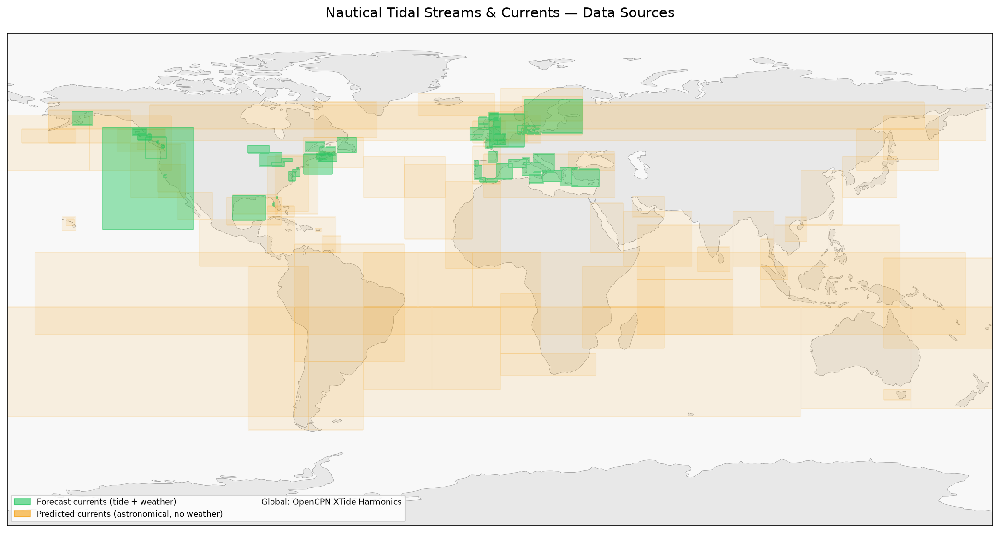
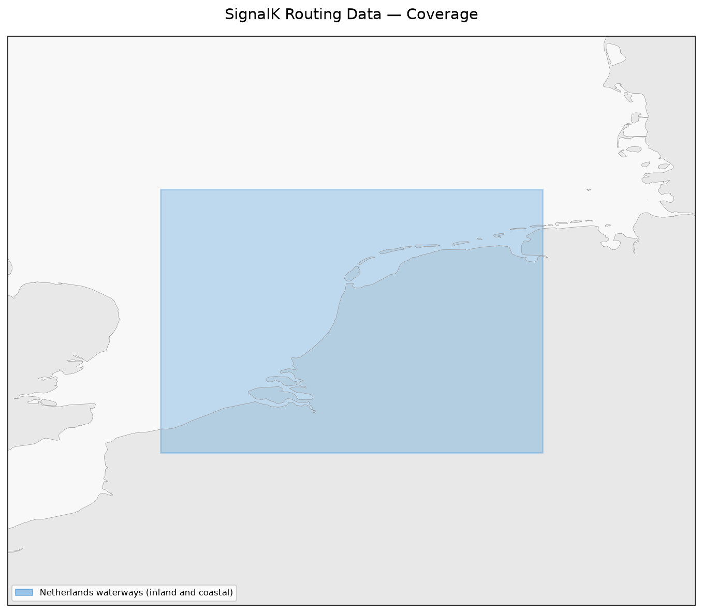

# Open Nautical Data — Tidal Currents, GRIB2 Forecasts & Waterway Routing

> **[Explore the Interactive Coverage Map & Data Catalog →](https://marcelrv.github.io/signalk-router-data/)**
> Pan, zoom, filter by type or tag, click any point to inspect overlapping datasets, and download regional GRIB2 files directly.
> Direct links: [Tidal & Currents](https://marcelrv.github.io/signalk-router-data/) · [GRIB2 Forecasts](https://marcelrv.github.io/signalk-router-data/?type=grib2) · [Routing Databases](https://marcelrv.github.io/signalk-router-data/?catalog=routing)

Open catalog of GRIB2 ocean current forecasts, predicted tidal stream tables (UTCEF & XTide harmonics), and pre-compiled nautical routing graphs. Built for the [SignalK Tidal Currents](https://github.com/marcelrv/signalk-tidal-currents) and [SignalK RouteIQ](https://github.com/marcelrv/signalk-routeiq) plugins — and the standard **GRIB2 current forecasts** and **XTide harmonics** can also be imported directly into **OpenCPN, qtVlm, XyGrib, LuckGrib, and Expedition/Adrena**.

**Two kinds of tidal/current data, worth knowing apart before picking a source:**
- **Predicted currents (astronomical, no weather)** — static harmonic tide tables, computed from the sun and moon alone. Small files, never need refreshing, but blind to wind, storm surge, and river flow.
- **Forecast currents (tide + weather)** — gridded ocean-model output that combines tides with wind, weather, and (where relevant) river discharge. Refreshed regularly — daily for most sources, up to 4x/day for a few — from real forecast models.

Both kinds appear on the [interactive coverage explorer](https://marcelrv.github.io/signalk-router-data/) and in the static [coverage map](#tidal-streams--currents) below.

**Licensing:** Code and tooling are [GPLv3](LICENSE). Original/compiled data catalogs are [CC-BY-NC-4.0](LICENSE-DATA.md). Routing databases may carry a different licence, stated in each file's own metadata (`metadata.license`, `metadata.copyright`); e.g. the Netherlands database is [ODbL-1.0](https://opendatacommons.org/licenses/odbl/1-0/). Third-party data sources (NOAA, CHS, BSH, FES2014, Rijkswaterstaat, OpenCPN) follow their own upstream terms; note that the CHS-derived files (`regions/north-america/canada/chs_*.utcef`) are **non-commercial use only and not for navigation** — see the [License & Attribution](#license--attribution) section below.

Routing databases are published as `.sqlite.gz` (gzip-compressed) assets on the rolling [**routing-databases-latest**](https://github.com/marcelrv/signalk-router-data/releases/tag/routing-databases-latest) release — the same way the forecast-current GRIB2 files are published — so rebuilding a region never grows this repository. The repo itself holds only the small `regions/**/*.index.json` descriptors that [`routing-index.json`](routing-index.json) is generated from. The plugin's download dialog resolves the release URL and handles decompression automatically.

## Coverage

### Tidal Streams & Currents

Click the map above to open the **[Interactive Tidal & Currents Explorer](https://marcelrv.github.io/signalk-router-data/)** (filter by GRIB2 / UTCEF / Harmonic, search by region or tag, zoom with OpenSeaMap seamarks, and click anywhere to inspect overlapping datasets). The raw GeoJSON is also available in [`tide-current-coverage.geojson`](tide-current-coverage.geojson).

### Routing Databases

Click the map above to open the **[Interactive Routing Databases Explorer](https://marcelrv.github.io/signalk-router-data/?catalog=routing)** for SignalK RouteIQ.

## Data Sources

Tidal/current data comes from three kinds of upstream sources, each suited to a different need:

| `type` | Source | What it provides |
|--------|--------|-------------------|
| `harmonic` | OpenCPN / XTide | ASCII harmonic constituents for named stations — small, static files, no refresh needed |
| `grib2` | BSH | Regional gridded current *forecasts* (tide + weather + river forcing) for the North Sea, Baltic and Elbe, refreshed per model cycle |
| `grib2` | NOAA NOS OFS | Regional gridded current *forecasts* for US waters (tide + weather + river forcing) from the NOS Operational Forecast Systems (currently Chesapeake Bay, San Francisco Bay, Salish Sea & Columbia River, northern Gulf of Mexico, West Coast, Gulf of Maine, Delaware Bay, Tampa Bay, Cook Inlet, Lakes Erie/Michigan-Huron/Ontario/Superior, New York Harbor, and the St. Johns River), extracted from model output and re-encoded as compact GRIB2 by [scripts/tide-current](scripts/tide-current/), refreshed daily via the rolling [`ofs-currents-latest`](https://github.com/marcelrv/signalk-router-data/releases/tag/ofs-currents-latest) release |
| `grib2` | Copernicus Marine (CMEMS IBI) | Regional gridded current *forecasts* (tide + weather + river forcing) for the Bay of Biscay, NW Iberia/Galicia, Portugal, and the Gulf of Cadiz/Gibraltar Strait, extracted from the Copernicus Marine IBI analysis-and-forecast model and re-encoded as compact GRIB2 by [scripts/tide-current](scripts/tide-current/), refreshed daily via the rolling [`ibi-currents-latest`](https://github.com/marcelrv/signalk-router-data/releases/tag/ibi-currents-latest) release |
| `grib2` | Copernicus Marine (CMEMS NWS) | Regional gridded current *forecasts* (tide + weather + river forcing) for the UK, Ireland and English Channel, extracted from the Copernicus Marine NWS (North West European Shelf) analysis-and-forecast model and re-encoded as compact GRIB2 by [scripts/tide-current](scripts/tide-current/), refreshed daily via the rolling [`nws-currents-latest`](https://github.com/marcelrv/signalk-router-data/releases/tag/nws-currents-latest) release |
| `grib2` | Copernicus Marine (CMEMS MED) | Regional gridded current *forecasts* (tide + weather forcing) for the Mediterranean Sea, extracted from the Copernicus Marine MED analysis-and-forecast model and re-encoded as compact GRIB2 by [scripts/tide-current](scripts/tide-current/), refreshed daily via the rolling [`med-currents-latest`](https://github.com/marcelrv/signalk-router-data/releases/tag/med-currents-latest) release |
| `grib2` | ECCC CIOPS | Regional gridded current *forecasts* (tide + weather + river forcing) for Canadian waters — BC central/north coast, Gulf Islands and Discovery Islands (500 m), Bay of Fundy, Nova Scotia, the southern Gulf of St. Lawrence, the St. Lawrence Estuary and Newfoundland — extracted from Environment and Climate Change Canada's CIOPS-East/West/Salish Sea coastal ocean models and re-encoded as compact GRIB2 by [scripts/tide-current](scripts/tide-current/), refreshed four times a day via the rolling [`ciops-currents-latest`](https://github.com/marcelrv/signalk-router-data/releases/tag/ciops-currents-latest) release |
| `grib2` | Rijkswaterstaat DCSM-FM | High-resolution (~250 m) gridded current *forecasts* (tide + wind + surge, depth-averaged) for the Dutch Wadden Sea and the Delta (Ooster-/Westerschelde, Voordelta, Haringvliet/Maasmond), hourly to +25 h (up to +48 h when the run has it) from the operational DCSM-FM 100 m model on the open [NOOS Matroos](https://noos.matroos.rws.nl/) server, regridded to a regular lat/lon grid by [scripts/tide-current](scripts/tide-current/), refreshed twice a day via the rolling [`dcsm-currents-latest`](https://github.com/marcelrv/signalk-router-data/releases/tag/dcsm-currents-latest) release. [CC-BY-4.0](https://creativecommons.org/licenses/by/4.0/), from Rijkswaterstaat open data (CC0) |
| `grib2` | MET Norway NorKyst v3 | Regional gridded surface current *forecasts* (tide + weather + river forcing) for the Norwegian coast and fjords (Skagerrak/Oslofjord, west coast, Nordland/Lofoten, Troms/Finnmark), extracted from the MET Norway NorKyst v3 (800 m) ocean model and re-encoded as compact GRIB2 by [scripts/tide-current](scripts/tide-current/), refreshed daily via the rolling [`norkyst-currents-latest`](https://github.com/marcelrv/signalk-router-data/releases/tag/norkyst-currents-latest) release |
| `utcef` | FES2014 (via AVISO+) | Dense-grid harmonic tidal current predictions derived from the FES2014 global tide model — static, no refresh needed |
| `utcef` | Rijkswaterstaat DCSM-FM (test) | **High-density** harmonic tidal streams for the Dutch Wadden Sea and the Ooster-/Westerschelde, Voordelta & Maasmond (~17,600 points, 150–500 m apart along the sailed channels), from harmonic analysis of RWS's DCSM-FM 100 m model, built by [scripts/DCSM-FM](scripts/DCSM-FM/) — **test release**: short record, spring–neap variation exaggerated until a 30+ day rebuild. [CC-BY-4.0](https://creativecommons.org/licenses/by/4.0/), from Rijkswaterstaat open data (CC0), except N2/K2, inferred with FES2014 ratios (AVISO+ licence, non-commercial) until the 30+ day rebuild |
| `utcef` | NOAA CO-OPS | Official harmonic constituents of ~850 NOAA current-prediction reference stations (US East/West Coast, Gulf of Mexico, Alaska, Hawaii, Puerto Rico), converted by [scripts/NOAA](scripts/NOAA/) — static, astronomical predictions valid for years |
| `utcef` | CHS (Canadian Hydrographic Service) | Harmonic tidal current predictions for the ~30 CHS current stations — BC passes and rapids (Seymour Narrows, Discovery Islands, Gulf Islands passes, Juan de Fuca, Johnstone Strait) and three Atlantic channels — fitted to one year of CHS predictions from the IWLS API by [scripts/CHS](scripts/CHS/) — static, astronomical predictions valid for years. Non-commercial, not for navigation |

See [specs/tide-current-catalog.md](specs/tide-current-catalog.md) for the full catalog schema and [specs/utcef-specification.md](specs/utcef-specification.md) for the UTCEF file format.

## Machine-Readable Catalogs

| Catalog | File | Spec |
|---------|------|------|
| Routing graph databases | [`routing-index.json`](routing-index.json) | [specs/routing-database-catalog.md](specs/routing-database-catalog.md) |
| Tide/current data sources | [`tide-current-index.json`](tide-current-index.json) | [specs/tide-current-catalog.md](specs/tide-current-catalog.md) |
| Unified Tidal and Current Exchange Format (UTCEF) | — | [specs/utcef-specification.md](specs/utcef-specification.md) |

## Quick Start

### RouteIQ (Routing)
1. Install the [SignalK RouteIQ nautical route planner](https://github.com/marcelrv/signalk-routeiq)
2. Set `routingDataDir` in the plugin config to a directory on your server
3. Download the `.sqlite.gz` file(s) for your region(s) from the [routing-databases-latest release](https://github.com/marcelrv/signalk-router-data/releases/tag/routing-databases-latest) or use the plugin's built-in "Manage Routing Data" dialog
4. The plugin automatically decompresses `.sqlite.gz` files on download — just use the dialog
5. Restart the plugin

Multiple `.sqlite` files can coexist in the same directory — the plugin merges them at startup.

### Tidal Currents (Signal K)
1. Install the [SignalK Tidal Currents](https://github.com/marcelrv/signalk-tidal-currents) plugin
2. The plugin reads `tide-current-index.json` to list available data sources
3. Download the sources for your region via the plugin UI (with automatic forecast refreshes)

### Other Marine Apps (OpenCPN, qtVlm, XyGrib, LuckGrib, Expedition)
- **Forecast currents (`.grb2`):** Browse the [Interactive GRIB2 Forecast Map](https://marcelrv.github.io/signalk-router-data/?type=grib2) and download the regional `.grb2` file directly, then open it in **OpenCPN** (built-in GRIB plugin → *Current* overlay), **qtVlm** (*GRIB → Open GRIB / Currents GRIB*), **XyGrib**, **LuckGrib**, or **Expedition/Adrena**.
- **Harmonic stations (`HARMONICS_*`):** Add directly in **OpenCPN** (*Options → Charts → Tides & Currents → Add Dataset*) or **XTide**.

## Contributing

We welcome new regions and data sources! See:
- [CONTRIBUTING.md](CONTRIBUTING.md) for routing database format and submission
- [specs/tide-current-catalog.md](specs/tide-current-catalog.md) for adding new tide/current data sources

## License & Attribution

### Routing databases

Each database file may have its own licence, which then takes precedence over CC-BY-NC-4.0. It is stated in the file's `metadata.license` and `metadata.copyright` fields, and the licence and link of every upstream source are in its `data_sources` table. Check individual file metadata for attribution and license information.

- **Netherlands (`europe_nl_nl-routing`)**: [ODbL-1.0](https://opendatacommons.org/licenses/odbl/1-0/), © 2026 Marcel Verpaalen. Contains data from Rijkswaterstaat (NWB vaarwegen incl. BRTN, ENC/IENC, VNDS; all [CC0-1.0](https://data.overheid.nl/)). Not for navigation.

### Tidal/current data

- **NOAA CO-OPS current stations** (`utcef` sources under `regions/north-america/usa/noaa_*.utcef`): derived from the official [NOAA Tides & Currents](https://tidesandcurrents.noaa.gov/) harmonic constituents — public domain, U.S. Government work (17 U.S.C. §105). Predictions are astronomical only; actual currents deviate with weather and river flow. Not an official NOAA product.
- **Rijkswaterstaat DCSM-FM forecast currents** (`grib2` source `rws_dcsm`, release `dcsm-currents-latest`): regridded from DCSM-FM model output on the open [NOOS Matroos](https://noos.matroos.rws.nl/) server by [scripts/tide-current](scripts/tide-current/), provided by Rijkswaterstaat (Ministry of Infrastructure and Water Management, the Netherlands) and Deltares as [open data](https://www.rijkswaterstaat.nl/zakelijk/open-data) (CC0 1.0). The derived files are [CC-BY-4.0](https://creativecommons.org/licenses/by/4.0/): **"Source: Rijkswaterstaat / Deltares DCSM-FM (NOOS Matroos); processed by signalk-router-data"**. Not an official Rijkswaterstaat product and not endorsed by Rijkswaterstaat or Deltares; **not for official navigation**, no liability accepted.
- **CHS current stations** (`utcef` sources under `regions/north-america/canada/chs_*.utcef`): harmonic constituents fitted by [scripts/CHS](scripts/CHS/) to the tidal current predictions of the [Canadian Hydrographic Service](https://www.tides.gc.ca/en), retrieved from its IWLS API. CHS data is **not** under the Open Government Licence – Canada; it is used under the [CHS Licence Agreement](https://www.tides.gc.ca/en/licence-agreement), so these files are for **non-commercial use only and not for navigation**, and may not be used in derivative products for sale or profit. As that licence requires, each file carries this notice (also in its `metadata.notice`):

  > This product is not to be used for navigation.
  > This product was made by or for the User Marcel Verpaalen (signalk-router-data) and contains intellectual property (Data) of the Canadian Hydrographic Service of the Department of Fisheries and Oceans.
  > The copyrights in the Data are and remain the property of His Majesty the King in Right of Canada and shall not be sold, licensed, leased, assigned or given to a third party.
  > The incorporation of the Data in this product does not constitute an endorsement or an approval of this product by the Canadian Hydrographic Service, the Department of Fisheries and Oceans or His Majesty the King in Right of Canada

  Predictions are astronomical only; actual currents deviate with weather and river flow. Where CHS and NOAA publish the same station (within 2 km), the NOAA copy is removed and the CHS one kept ([scripts/FES2014/cull_near_stations.py](scripts/FES2014/cull_near_stations.py)). The coarse FES2014 grid around CHS stations is deliberately kept: CHS has only ~30 point stations, so removing nearby FES2014 points would leave holes in the area coverage.
- **NOAA NOS OFS surface currents** (`grib2` files on the [`ofs-currents-latest`](https://github.com/marcelrv/signalk-router-data/releases/tag/ofs-currents-latest) release): surface u/v extracted and re-encoded from official [NOAA NOS Operational Forecast System](https://tidesandcurrents.noaa.gov/ofs/) model guidance — public domain, U.S. Government work (17 U.S.C. §105). These files are subsampled, repackaged model guidance produced by this repository — **not an official NOAA product** and not endorsed by NOAA; do not use for primary navigation.
- **Copernicus Marine (CMEMS IBI) surface currents** (`grib2` files on the [`ibi-currents-latest`](https://github.com/marcelrv/signalk-router-data/releases/tag/ibi-currents-latest) release): surface u/v extracted and re-encoded from the [Copernicus Marine Service](https://data.marine.copernicus.eu/product/IBI_ANALYSISFORECAST_PHY_005_001/description) IBI analysis-and-forecast model, redistributed under the [Copernicus Marine license](https://marine.copernicus.eu/user-corner/service-commitments-and-licence). Per the license's terms for a modified/reformatted product: **"Generated using E.U. Copernicus Marine Service Information (https://doi.org/10.48670/moi-00027)"**. These files are geographically subsetted and reformatted from netCDF to GRIB2 by this repository — **not an official Copernicus product** and not endorsed by Mercator Ocean International; do not use for primary navigation.
- **Copernicus Marine (CMEMS NWS) surface currents** (`grib2` files on the [`nws-currents-latest`](https://github.com/marcelrv/signalk-router-data/releases/tag/nws-currents-latest) release): surface u/v extracted and re-encoded from the [Copernicus Marine Service](https://data.marine.copernicus.eu/product/NWSHELF_ANALYSISFORECAST_PHY_004_013/description) NWS (North West European Shelf) analysis-and-forecast model, produced by the UK Met Office (NWS-MFC) and redistributed under the same [Copernicus Marine license](https://marine.copernicus.eu/user-corner/service-commitments-and-licence). Per the license's terms for a modified/reformatted product: **"Generated using E.U. Copernicus Marine Service Information (https://doi.org/10.48670/moi-00054)"**. These files are geographically subsetted and reformatted from netCDF to GRIB2 by this repository — **not an official Copernicus product** and not endorsed by the Met Office or Mercator Ocean International; do not use for primary navigation.
- **Copernicus Marine (CMEMS MED) surface currents** (`grib2` files on the [`med-currents-latest`](https://github.com/marcelrv/signalk-router-data/releases/tag/med-currents-latest) release): surface u/v extracted and re-encoded from the [Copernicus Marine Service](https://data.marine.copernicus.eu/product/MEDSEA_ANALYSISFORECAST_PHY_006_013/description) MED (Mediterranean Sea Physics) analysis-and-forecast model, produced by CMCC (Italy) and redistributed under the same [Copernicus Marine license](https://marine.copernicus.eu/user-corner/service-commitments-and-licence). Per the license's terms for a modified/reformatted product: **"Generated using E.U. Copernicus Marine Service Information (https://doi.org/10.48670/mds-00359)"**. These files are geographically subsetted and reformatted from netCDF to GRIB2 by this repository — **not an official Copernicus product** and not endorsed by CMCC or Mercator Ocean International; do not use for primary navigation.
- **ECCC CIOPS surface currents** (`grib2` files on the [`ciops-currents-latest`](https://github.com/marcelrv/signalk-router-data/releases/tag/ciops-currents-latest) release): surface u/v extracted and re-encoded from Environment and Climate Change Canada's [Coastal Ice Ocean Prediction System](https://eccc-msc.github.io/open-data/msc-data/nwp_ciops/readme_ciops_en/) (CIOPS-East, CIOPS-West, CIOPS-Salish Sea) as published on the MSC Datamart, redistributed under the [ECCC Data Services End-use Licence](https://eccc-msc.github.io/open-data/licence/readme_en/), which allows commercial use. **"Data Source: Environment and Climate Change Canada. Contains information licenced under the Data Server End-use Licence of Environment and Climate Change Canada."** These files are geographically subsetted and reformatted from NetCDF to GRIB2 by this repository — **not an official ECCC product** and not endorsed by ECCC. Model currents in narrow passes and rapids are much weaker than reality; do not use for primary navigation.
- **MET Norway NorKyst v3 surface currents** (`grib2` files on the [`norkyst-currents-latest`](https://github.com/marcelrv/signalk-router-data/releases/tag/norkyst-currents-latest) release): surface u/v regridded and re-encoded from the [NorKyst v3](https://thredds.met.no/thredds/catalog/fou-hi/norkystv3.html?dataset=norkystv3_800m_m00_be) ocean model. **Based on data from the Norwegian Meteorological Institute (MET Norway), licensed under [CC-BY-4.0](https://creativecommons.org/licenses/by/4.0/)** ([crediting](https://www.met.no/en/free-meteorological-data/Licensing-and-crediting)). Open sea far from land is left out. Straits narrower than the 800 m model grid (e.g. Saltstraumen, Rystraumen) are not resolved and show no or far too weak current; these files are not an official MET Norway product and not endorsed by MET Norway; do not use for primary navigation.
- **Rijkswaterstaat DCSM-FM high-density tidal streams** (`utcef` sources `regions/europe/wadden_dcsm_hd.utcef`, `regions/europe/delta_dcsm_hd.utcef`): tidal current harmonic constituents derived by [scripts/DCSM-FM](scripts/DCSM-FM/) from DCSM-FM model output on the open [NOOS Matroos](https://noos.matroos.rws.nl/) server, provided by Rijkswaterstaat (Ministry of Infrastructure and Water Management, the Netherlands) and Deltares as [open data](https://www.rijkswaterstaat.nl/zakelijk/open-data) (CC0 1.0). The derived files are [CC-BY-4.0](https://creativecommons.org/licenses/by/4.0/): **"Source: Rijkswaterstaat / Deltares DCSM-FM (NOOS Matroos); processed by signalk-router-data"**. Exception: in the current test release the N2 and K2 constituents are inferred with amplitude ratios and phase offsets from FES2014 (via `regions/europe/netherlands.utcef`), so those values fall under the AVISO+ licence (scientific and non-commercial use) and require the citation *"FES2014 was produced by Noveltis, Legos and CLS and distributed by Aviso+, with support from Cnes"*. The planned 30+ day rebuild fits N2 directly and infers K2 from the equilibrium-tide ratio, removing FES2014 from these files. Not an official Rijkswaterstaat or Hydrographic Office product and not endorsed by them; **not for official navigation**, no liability accepted.
- **OpenCPN / XTide harmonics** (`harmonic` sources): see the [OpenCPN project](https://github.com/OpenCPN/OpenCPN/tree/master/data/tcdata) for licensing of the underlying station data.
- **UTCEF / FES2014-derived datasets** (`utcef` sources, e.g. files under [`regions/europe`](regions/europe)): derived from the FES2014 global tide model, produced by Noveltis, LEGOS and CLS and distributed by AVISO+, with support from CNES. Redistribution follows the [AVISO+ License Agreement](https://www.aviso.altimetry.fr/fileadmin/documents/data/License_Aviso.pdf) (scientific and non-commercial use).

  **These derived datasets are not endorsed by, affiliated with, or supported by AVISO, CNES, or any FES2014 copyright holder.** If you use this data, please cite: *"FES2014 was produced by Noveltis, Legos and CLS and distributed by Aviso+, with support from Cnes (https://www.aviso.altimetry.fr/)"*. To access the raw global FES2014 dataset directly, visit [AVISO+](https://www.aviso.altimetry.fr/en/data/products/auxiliary-products/global-tide-fes.html).

---

*Maintained by the SignalK RouteIQ and Tidal Currents community.*
